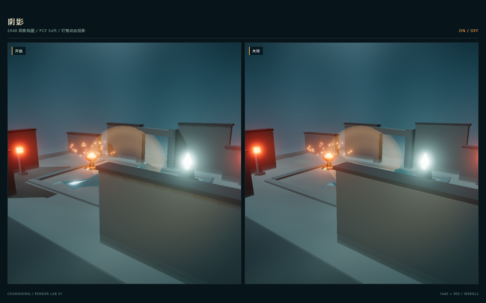
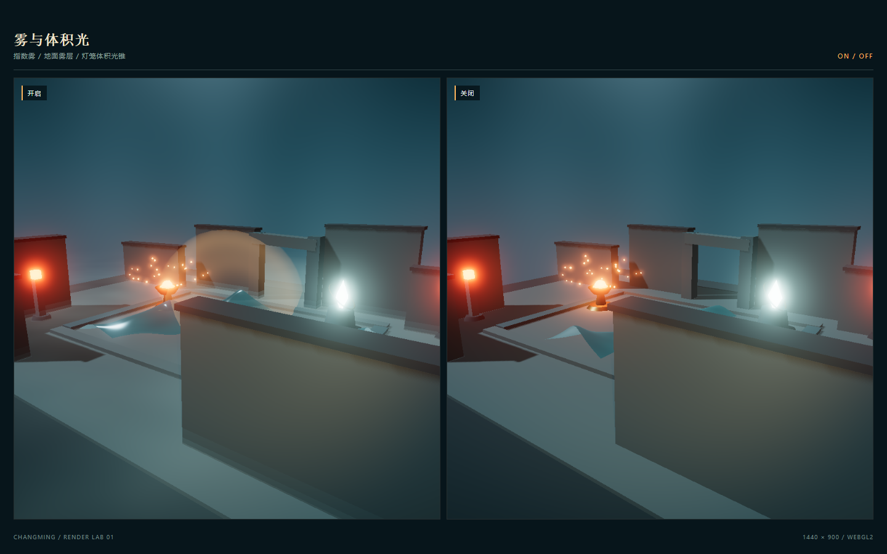
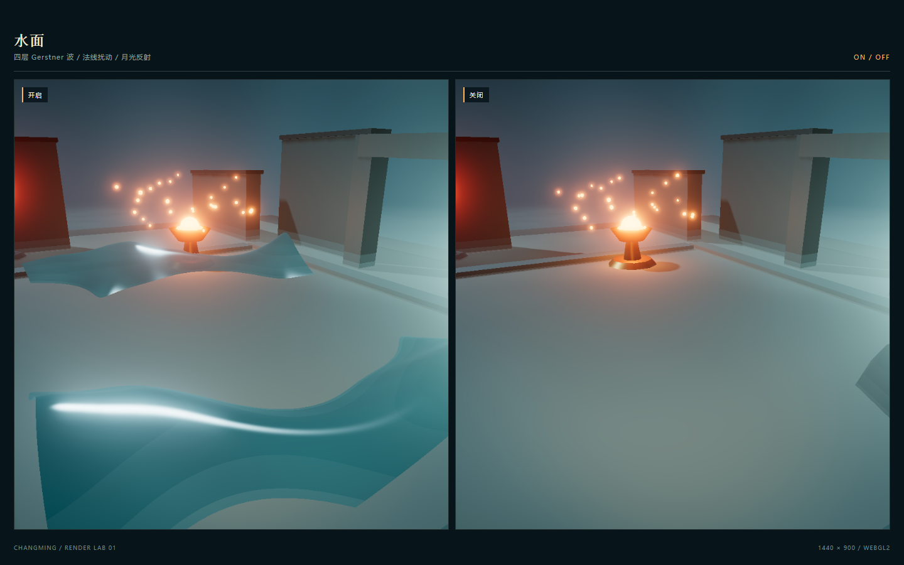
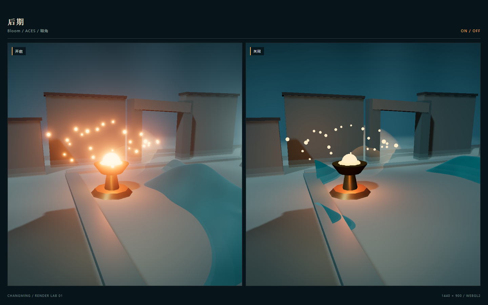

# 黄勇杰 第一周交付

分支：`feat/huang-render`

周期：2026-11-16 至 2026-11-22

## 本周目标

完成可独立接入的渲染管线，覆盖三类光源、动态阴影、指数雾与体积光、Gerstner 水面、
Bloom / ACES / 暗角、PBR / Blinn-Phong 切换、高低画质档和可开关特性。

本次只新增文件，未修改 `index.html`、`src/main.js`、`package.json` 或任何原始源码。
验收入口为独立的 `render-lab.html`。

## 管线结果

```text
场景
  -> 月光平行光 + 灯笼聚光 + 火盆点光
  -> 2048 阴影贴图 / PCF Soft / 灯笼阴影跟随
  -> 四层 Gerstner 水面
  -> 指数雾 + 地面雾层 + 灯笼体积光锥
  -> HalfFloat HDR 缓冲
  -> Bloom
  -> 暗角
  -> ACES Filmic
  -> sRGB
```

对应每日任务：

| 日期 | 交付 |
| --- | --- |
| 11.16 | 管线图、独立空场景基准、three.js 集成边界 |
| 11.17 | 月光、灯笼、火盆三类光源；PBR / Blinn-Phong 切换 |
| 11.18 | 高质量 2048 阴影、PCF Soft、灯笼动态投影、bias / normalBias |
| 11.19 | 指数雾、三层地面雾、灯笼体积光柱，可独立开关 |
| 11.20 | Gerstner 水面、法线扰动、简化月光反射、Bloom、ACES、暗角 |
| 11.21 | `setFeature` 六项开关、三档画质、固定验收机位 |
| 11.22 | 四张对比图、实测数据、接入说明和下周清单 |

## 特性开关

| 名称 | 效果 |
| --- | --- |
| `shadow` | 总阴影开关，对比灯笼和月光投影 |
| `lantern` | 相机跟随灯笼聚光 |
| `volumetric` | 指数雾、地面雾层、体积光锥 |
| `water` | Gerstner 水面 |
| `bloom` | HDR Bloom，保留 ACES 和暗角 |
| `pbr` | PBR 与 Blinn-Phong 材质切换 |

## 验收数据

自动验收环境：

- Chrome Headless + SwiftShader
- 视口 1440 × 900
- WebGL 2.0
- 控制台 error：0
- 高质量：约 300 FPS，165 draw calls，59,405 triangles
- 低画质：约 298 FPS，151 draw calls，18,357 triangles

SwiftShader 数据只用于回归稳定性，不代表真实显卡帧率。低画质仍保留阴影、雾、体积光、
水面和 Bloom，只降低像素比、阴影贴图、水面网格和 Bloom 参数。

完整结果见 [render-results.json](screenshots/render-results.json)。

## 对比截图

### 阴影



### 雾与体积光



### 水面



### 后期



## 复现命令

```bash
node tools/build-render-lab.mjs
node tools/capture-render-comparisons.cjs
```

构建后直接打开 `render-lab.html`，可使用右侧面板切换机位、画质和渲染特性。

## 接入说明

当前没有修改项目入口。集成时需要在 `src/main.js` 新增两处调用：

```js
import { createRenderPipeline } from './render/index.js'

const renderPipeline = createRenderPipeline({
  scene: renderer.scene,
  camera: renderer.camera,
  renderer: renderer.renderer,
  engine: renderer,
  quality: state.quality,
})
```

渲染循环内：

```js
renderPipeline.update(dt)
renderPipeline.render(dt)
```

若与王圣杰的真实迷宫世界对接，可将水面参数改为外海或水院尺寸，并把 B 模块
`world.ocean.group` 作为占位或替换对象。接口无需改动。

## 下周待补

- 将体积光锥升级为屏幕空间射线步进，并读取场景深度。
- 水面增加屏幕空间反射与岸边泡沫深度遮罩。
- 接入真实迷宫世界后重新测 draw call，目标保持在 40 个场景 draw call 附近。
- 在真实 GPU 上补 1440 × 900 和 1920 × 1080 帧率记录。
