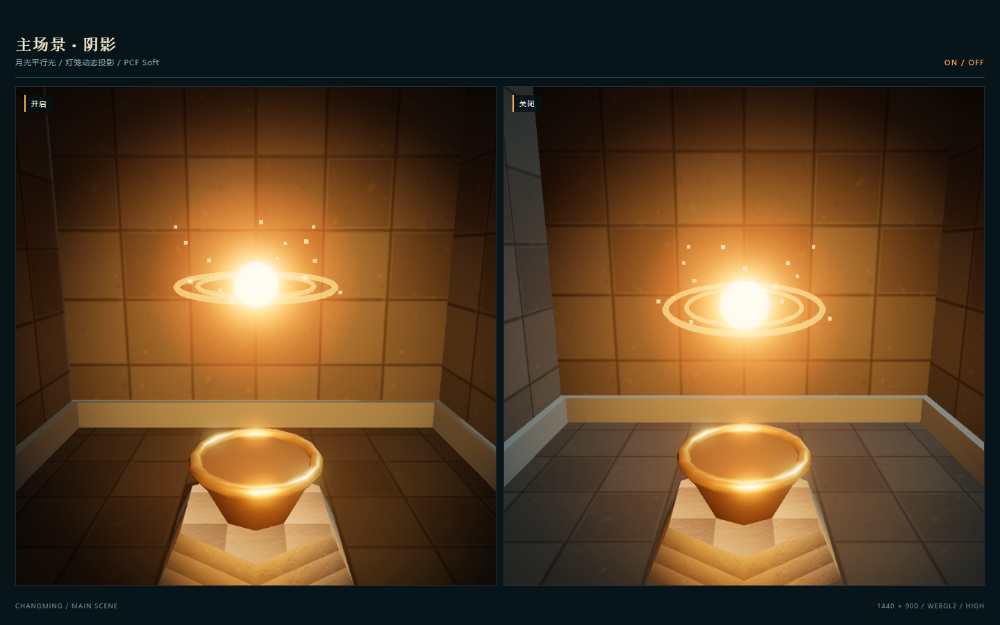
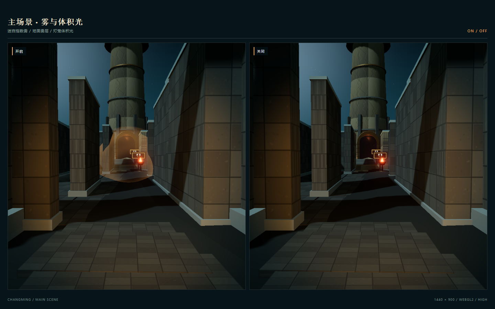
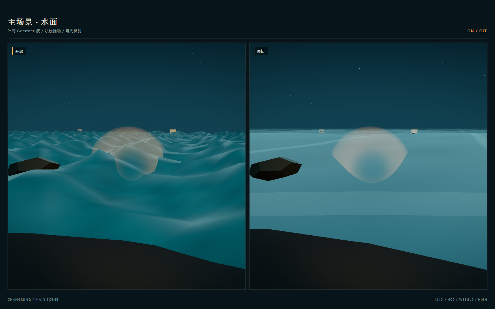
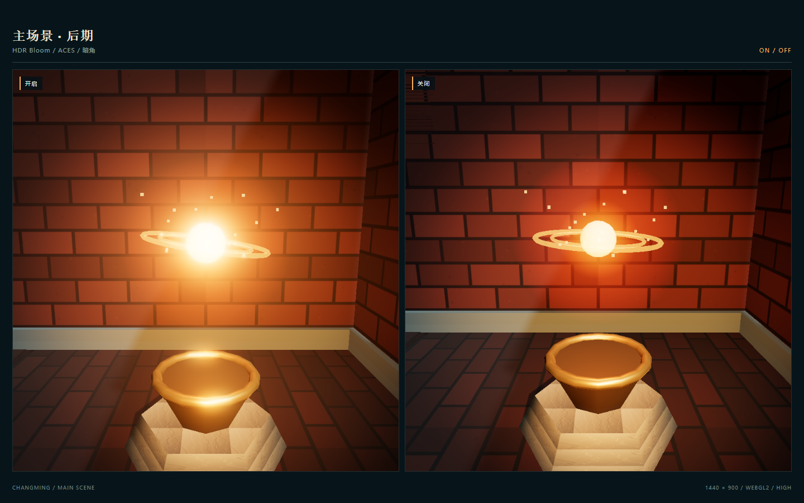
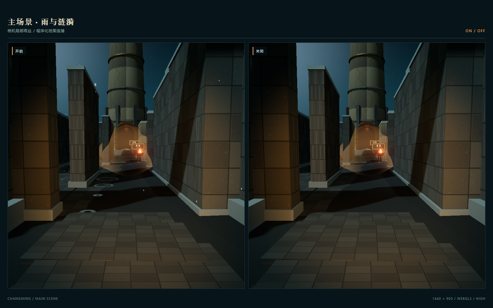

# 黄勇杰 第二周交付

周期：2026-11-23 至 2026-11-29

本周把第一周的独立渲染管线接入真实迷宫主场景，完成七项可开关特性、真实场景参数调优、
主场景技术对比图和 Chrome / Edge 性能记录。

## 本周结果

| 任务 | 状态 | 结果 |
| --- | --- | --- |
| 主管线接入 | 完成 | `src/main.js` 使用 `createRenderPipeline()` 接管每帧渲染 |
| 去除重复光照 | 完成 | 移除 `atmosphere-legacy` 光源，玩家灯笼替换为管线 SpotLight |
| 独立回归页 | 完成 | `render-lab.html` 保留并与主场景共用同一管线 |
| 主场景调优 | 完成 | 收敛 Bloom 高光、体积光密度和雨/涟漪亮度 |
| 雨 / 地面涟漪 | 完成 | 新增 `rain` 特性，默认关闭，可由 URL/诊断接口开启 |
| 技术对比截图 | 完成 | 4 张核心对比图 + 1 张雨/涟漪附加图 |
| 性能记录 | 完成 | Chrome / Edge 各测高、低画质，均为真实 GPU 路径 |

## 主场景管线

```text
真实迷宫世界
  -> 月光平行光 + 灯笼聚光 + 火盆点光
  -> 2048 / 1536 / 1024 PCF Soft 阴影
  -> Gerstner 水面（按需替换 B 模块外海）
  -> 指数雾 + 地面雾层 + 灯笼体积光
  -> 相机局部雨丝 + 程序化地面涟漪（可选）
  -> HalfFloat HDR RenderTarget
  -> Bloom
  -> 暗角
  -> ACES Filmic
  -> sRGB
```

`atmosphere-legacy` 只保留夜空、星、月与基础雾；旧光源会被移除。`water` 开启时隐藏
B 模块的 `world.ocean.mesh`，避免两层海面重叠。

## 特性开关

| 名称 | 主场景效果 | 高画质 | 中画质 | 低画质 |
| --- | --- | --- | --- | --- |
| `shadow` | 月光与灯笼阴影总开关 | 开 | 开 | 开 |
| `lantern` | 跟随相机的动态灯笼 | 开 | 开 | 开 |
| `volumetric` | 指数雾、地面雾层、灯笼光锥 | 开 | 关 | 关 |
| `water` | 替换外海的 Gerstner 水面 | 默认关 | 默认关 | 默认关 |
| `rain` | 相机局部雨丝与地面涟漪 | 默认关 | 默认关 | 默认关 |
| `bloom` | HDR Bloom，保留 ACES / 暗角 | 开 | 开 | 关 |
| `pbr` | PBR / Blinn-Phong 可逆切换 | PBR | PBR | Blinn-Phong |

调试示例：

```text
index.html?quality=high&water=1&rain=1&bloom=0
```

七项特性均可通过 `window.changming.setFeature(name, enabled)` 开关。

## 真实场景调优

- 高画质 Bloom 从 `0.46 / 0.62 / 0.82` 收敛到 `0.40 / 0.56 / 0.90`
  （strength / radius / threshold），降低火种高光过曝。
- 体积光高画质透明度从 `0.20` 降到 `0.17`，保持光锥可读并减少中心雾块。
- `rain` 使用 1800 / 1200 / 720 个相机局部雨滴；地面涟漪使用单平面程序化 shader。
- 低画质继续保留阴影和灯笼，关闭体积光、Bloom 并切到 Blinn-Phong，保证道路可读性。

## 技术对比

### 阴影



### 雾与体积光



### 水面



### 后期



### 雨与地面涟漪



四张核心对比图的平均像素差异为：阴影 `6.065%`、体积光 `0.536%`、
水面 `8.083%`、后期 `7.581%`；附加雨/涟漪为 `0.099%`。

## 性能记录

测试条件：

- seed `20261205`，固定机位，1440 × 900，DPR 1；
- Chrome / Edge Headless，ANGLE D3D11；
- GPU：NVIDIA GeForce RTX 4060 Laptop GPU；
- 画质切换后预热 3.5 秒，再用 `requestAnimationFrame` 连续采样 2.5 秒；
- 浏览器垂直同步未限制帧率，FPS 是实际提交帧数计算结果。

| 浏览器 | 画质 | FPS | Draw calls | Triangles |
| --- | --- | ---: | ---: | ---: |
| Chrome | high | 292.3 | 256 | 191,331 |
| Chrome | low | 300.0 | 163 | 113,677 |
| Edge | high | 278.8 | 256 | 191,331 |
| Edge | low | 299.8 | 163 | 113,677 |

结果满足“1440×900 目标 60fps、低画质保 30fps”。完整原始数据见
[main-render-results.json](screenshots/main-render-results.json)。单次采样会随系统负载波动，
表格保留最终回归快照。

## 复现

```bash
npm install
npm run build
npm run capture:main-render
npm run capture:render-lab
npm test
```

`capture:main-render` 会自动构建 `dist/bundle.js`，重新生成五张主场景对比图和性能 JSON。

## 第三周待补

1. 把灯笼体积光锥升级为读取场景深度的屏幕空间光线步进。
2. 为 Gerstner 水面补屏幕空间反射与基于深度的岸边泡沫遮罩。
3. 在 1920 × 1080、DPR 2 和真实游玩相机路径下补连续帧率统计与 99th percentile frame time。
4. 将雨声、水院环境音与 `rain` 特性绑定，补静音和音量设置。
5. 与迷宫模块继续压低全场景 draw calls，目标是先稳定到 150 以下。
